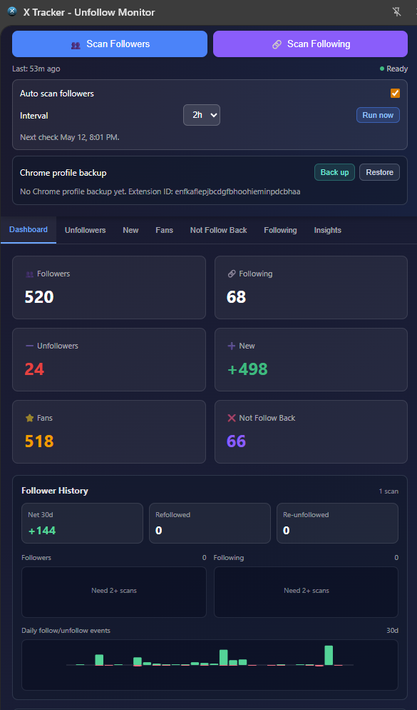
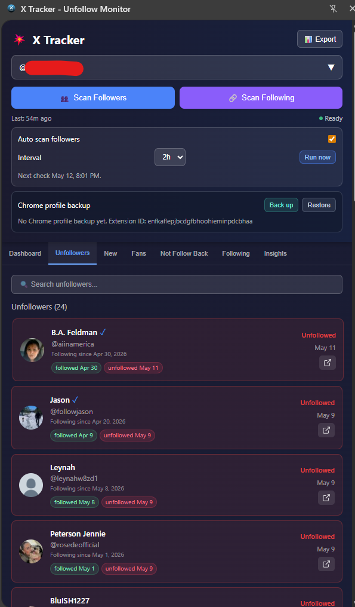
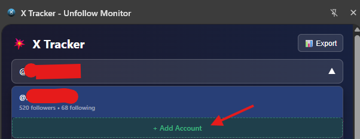

# X Tracker - Unfollow & Social Media Monitoring Side Panel 🔍

<div align="center">

[](https://opensource.org/licenses/MIT)
[](https://github.com/Sterlites/X-Unfollow)
[-1DA1F2?style=flat&logo=twitter&logoColor=white)](https://x.com)
[](https://github.com/Sterlites/X-Unfollow)
[](https://github.com/Sterlites/X-Unfollow)
[](https://github.com/Sterlites/X-Unfollow)

</div>

> **Free, private X (Twitter) tracker for small to medium accounts — Track who unfollowed you, detect handle renames, and monitor your social circle directly inside your browser side panel. No paid API keys required. 100% local and private.**

<div align="center">
  
  <h2>X Tracker</h2>
  <p><em>Never wonder who unfollowed you again | Works right inside your browser side panel</em></p>
</div>

---

## 📑 Quick Navigation

- [🌟 Features](#-features)
- [📸 Screenshots](#-screenshots)
- [🚀 Installation (Beginner Friendly)](#-installation)
  - [⚡ Option 1: 1-Click Automated Setup (Fastest)](#-option-1-1-click-automated-setup-recommended)
  - [🖱️ Option 2: Step-by-Step Manual Setup (Foolproof)](#-option-2-step-by-step-manual-setup)
  - [📌 Pinning the Extension](#-step-5-pin-the-extension-to-your-toolbar)
  - [🌐 Browser Guides (Chrome, Brave, Edge, Opera)](#-browser-specific-notes)
- [🎯 First-Time Quickstart](#-how-to-use-first-time-walkthrough)
- [📊 Dashboard & Features](#-dashboard-features)
- [⚡ Performance Guidelines](#-performance-guidelines)
- [🔒 Privacy & Security](#-privacy--security)
- [🛠️ Troubleshooting & Beginner FAQ](#-troubleshooting--beginner-faq)
- [📦 File Structure](#-file-structure)
- [🤝 Contributing & Support](#-contributing)

---

## 🌟 Features

<div align="center">
<table>
  <tr>
    <td align="center" width="50%">
      
      <h3>Followers & Unfollowers</h3>
      <p>Instantly see who followed or unfollowed you since your last scan</p>
    </td>
    <td align="center" width="50%">
      
      <h3>Multi-Account Support</h3>
      <p>Track multiple personal and business X profiles seamlessly</p>
    </td>
  </tr>
  <tr>
    <td align="center" width="50%">
      
      <h3>Visual Analytics & Charts</h3>
      <p>Clean SVG trend lines, follower history, and net change graphs</p>
    </td>
    <td align="center" width="50%">
      
      <h3>100% Privacy & Local Storage</h3>
      <p>Data is stored strictly in your browser (IndexedDB). No cloud, no tracking</p>
    </td>
  </tr>
  <tr>
    <td align="center" width="50%">
      
      <h3>Handle Rename Detection</h3>
      <p>Uses immutable numeric IDs so people changing their @handle are never falsely reported as unfollowers</p>
    </td>
    <td align="center" width="50%">
      
      <h3>Stuck Scan Safeguards</h3>
      <p>Automatic 5-minute watchdog timers, force-stop controls, and crash recovery</p>
    </td>
  </tr>
</table>
</div>

---

## 📸 Screenshots

<div align="center">
  
### Side Panel Dashboard


### Unfollowers Audit View


### Multi-Account Switcher


</div>

---

## 🚀 Installation

> [!NOTE]
> **No programming or technical skills are required!** Setting this up takes less than 60 seconds. Choose whichever installation method you prefer below.

---

### ⚡ Option 1: 1-Click Automated Setup (Recommended)

If you are on Windows or macOS/Linux, you can use our built-in 1-click helper script to automatically open the right browser page and copy the folder path for you:

#### On Windows:
1. **Download the project**:
   - Click the green **Code** button at the top of GitHub, then click **[Download ZIP](https://github.com/Sterlites/X-Unfollow/archive/refs/heads/super-se-upar.zip)**.
2. **Extract the ZIP file**:
   - Right-click the downloaded `.zip` file, choose **Extract All...**, and click **Extract**.
3. **Double-click `install.bat`**:
   - Inside the extracted folder, double-click **`install.bat`**.
   - The script will copy the folder path to your clipboard and automatically open your browser to `chrome://extensions`.
4. **Finish in 2 clicks in your browser**:
   - Turn **ON** the **Developer mode** toggle in the top-right corner.
   - Click the **Load unpacked** button in the top-left corner.
   - In the folder picker dialog, press **Ctrl + V** (to paste the path) and click **Select Folder**.
   - 🎉 That's it! Look for the puzzle icon 🧩 in your browser toolbar to pin X Tracker.

#### On macOS or Linux:
1. Download and extract the repository ZIP.
2. Open Terminal in the extracted folder and run:
   ```bash
   chmod +x install.sh && ./install.sh
   ```
3. Toggle **Developer mode** ON, click **Load unpacked**, paste the path, and click **Select**.

---

### 🖱️ Option 2: Step-by-Step Manual Setup

If you prefer to set it up manually without scripts, follow these 5 foolproof steps:

#### Step 1: Download & Extract the Files
1. Download the ZIP by clicking: **[Download ZIP](https://github.com/Sterlites/X-Unfollow/archive/refs/heads/super-se-upar.zip)**.
2. Open your `Downloads` folder.
3. **Crucial Step**: Right-click the downloaded `X-Unfollow-super-se-upar.zip` and select **"Extract All..."** (Windows) or double-click to unarchive (Mac).

> [!WARNING]
> **Do not skip extraction!** Trying to load directly from inside a compressed `.zip` file will cause an error: *"Manifest file is missing or unreadable"*. Make sure you open the **extracted folder**.

Your extracted folder should contain these exact files:
```text
📁 X-Tracker/                 <--- This is the folder you will select!
   ├── manifest.json          <--- Must be directly inside this folder
   ├── install.bat
   ├── background.js
   ├── sidepanel.html
   ├── content/
   ├── shared/
   └── sidepanel/
```

#### Step 2: Open your Browser Extensions Page
Open your web browser (Google Chrome, Brave, Microsoft Edge, or Opera) and navigate to the Extensions management page:

| Browser | Address Bar URL (Copy & Paste) | Menu Shortcut |
| :--- | :--- | :--- |
| **Google Chrome** | `chrome://extensions` | Click **⋮** (top right) → **Extensions** → **Manage Extensions** |
| **Brave Browser** | `brave://extensions` | Click **☰** (top right) → **Extensions** |
| **Microsoft Edge** | `edge://extensions` | Click **⋯** (top right) → **Extensions** → **Manage Extensions** |
| **Opera** | `opera://extensions` | Click **O** menu → **Extensions** → **Extensions** |

> [!TIP]
> Browsers do not allow web links to automatically open `chrome://` URLs for security reasons. Simply copy `chrome://extensions`, paste it into your browser's address bar, and press **Enter**.

#### Step 3: Turn ON "Developer mode"
Look at the **top-right corner** of the Extensions page. Find the **"Developer mode"** toggle switch and click it so it turns **ON (blue)**:

```text
                                              ┌───────────────────────┐
  Extensions                                  │  Developer mode  [ON] │  <-- Toggle this ON!
                                              └───────────────────────┘
```

#### Step 4: Click "Load unpacked"
Once Developer mode is enabled, new buttons will appear in the top-left area:
1. Click the **"Load unpacked"** button.
2. A file selection window will open.
3. Browse to and select the **extracted `X-Tracker` folder** (the one containing `manifest.json`).
4. Click **Select Folder** (or **Open**).

<div align="center">
  
</div>

#### Step 5: Pin the Extension to your Toolbar!
By default, browsers hide newly installed extensions under the puzzle piece icon. Make sure you pin it so you can open it with one click:
1. In your browser's top toolbar, click the **Puzzle piece icon (🧩)** next to your address bar.
2. Find **X Tracker - Unfollow Monitor**.
3. Click the **Pin icon (📌)** next to it.
4. The X Tracker icon will now stay visible on your toolbar!

---

### 🌐 Browser-Specific Notes

- **Google Chrome**: Works natively on Chrome 116 or newer with the Chrome Side Panel API.
- **Brave Browser**: Brave fully supports Chrome extensions and the side panel. Make sure "Developer mode" is toggled ON in `brave://extensions`.
- **Microsoft Edge**: In `edge://extensions`, toggle **"Developer mode"** in the left sidebar, then click **"Load unpacked"**.
- **Opera / Vivaldi**: Enable Developer mode in their extensions page and load the unpacked directory.

---

## 📋 System Requirements

- **Browser**: [Google Chrome](https://www.google.com/chrome/), Brave, Microsoft Edge, or Chromium-based browser (Version **116+** required for the Side Panel API).
- **Account**: An active [X (Twitter)](https://x.com) account logged into your browser.
- **Connection**: Standard stable internet connection.
- **Privileges**: No administrator permissions or root access required.

---

## 🎯 How to Use (First-Time Walkthrough)

### 1. Make Sure You Are Logged In to X
Open a tab and go to [x.com](https://x.com). Make sure you are signed in to your account.

### 2. Open the Side Panel
Click the **X Tracker icon** in your browser toolbar (or click the Side Panel icon). The X Tracker dashboard will slide out on the right side of your browser.

### 3. Add Your Account
1. Click the **`+` (Add Account)** button in the header.
2. Type your X username (without the `@` symbol, e.g., `Sterlites`).
3. Click **Add Account**.

### 4. Run Your First Scan
1. In the account dropdown, select your account.
2. Click **"🧑‍🤝‍🧑 Scan Followers"** (or **"🔗 Scan Following"**).
3. A dedicated scanner tab will open and automatically scroll through your follower list using passive GraphQL observation.
4. **Do not close the scan tab manually** — it will close itself automatically when the scan finishes!
5. Once complete, your dashboard will update with your exact follower counts, recent changes, and unfollowers list.

<div align="center">
  
</div>

---

## 📊 Dashboard Features

### Real-Time Metric Tiles
<div align="center">
<table>
  <tr>
    <td align="center"><b>👥 Followers</b></td>
    <td align="center"><b>🔗 Following</b></td>
    <td align="center"><b>💔 Unfollowers</b></td>
    <td align="center"><b>✨ New Followers</b></td>
  </tr>
  <tr>
    <td align="center"><code>Current count & net delta</code></td>
    <td align="center"><code>Accounts you follow</code></td>
    <td align="center"><code>People who unfollowed you</code></td>
    <td align="center"><code>New followers gained</code></td>
  </tr>
</table>
</div>

### Navigation Tabs
- **📊 Dashboard**: High-level visual summary, metric cards, and follower trend lines.
- **💔 Unfollowers**: Chronological list of who unfollowed you, with timestamps, bio previews, verification badges, and quick links.
- **✨ New**: Recently acquired followers since your previous scan.
- **🔗 Following**: Complete list of accounts you are currently following.
- **⚙️ Settings & Export**: Export your data to CSV or Markdown, configure dark/light theme, set whitelist rules, and adjust scan preferences.

---

## ⚡ Performance Guidelines

Because X loads followers dynamically in batches as you scroll down, scan times vary depending on your follower count:

| Follower Count | Estimated Scan Time | Tips for Best Results |
| :--- | :--- | :--- |
| **< 1,000** | 30 seconds - 2 minutes | ⚡ Lightning fast and smooth |
| **1,000 - 5,000** | 3 - 8 minutes | ☕ Grab a coffee while the scan tab runs in the background |
| **5,000 - 15,000** | 8 - 20 minutes | 📶 Keep your internet connection stable |
| **15,000+** | 20+ minutes | ⚠️ X rate limits large automated requests; use off-peak hours |

> 💡 **Pro Tip**: Keep your scans to 1-2 times per day. There is no need to scan continuously, and spacing out scans keeps your account activity looking completely natural.

---

## 🔒 Privacy & Security

We built X Tracker with a strict **Privacy-First** architecture:

- 🔒 **Zero External Servers**: The extension communicates only with `x.com` directly within your browser. There is no backend server, telemetry server, or analytics ping.
- 🔑 **No Passwords or API Keys**: The extension uses your existing browser session cookies to read your follower lists. It never sees or asks for your password.
- 💾 **Local IndexedDB Database**: All scanned follower histories, timestamps, and usernames are stored locally on your machine in browser storage (`XTrackerDB`).
- 🧹 **1-Click Data Wipe**: You can export your data to CSV or JSON, or erase all stored history at any time from the Settings dialog.

---

## 🛠️ Troubleshooting & Beginner FAQ

### Beginner Gotchas & Setup Questions

#### ❓ Error: *"Manifest file is missing or unreadable"*
- **Cause**: You selected the outer zip folder or a parent folder instead of the folder that directly contains `manifest.json`.
- **Fix**: Open the folder in File Explorer / Finder. Make sure you see `manifest.json` right in front of you. In the "Load unpacked" dialog, select that exact folder.

#### ❓ Clicking `chrome://extensions` on GitHub does nothing
- **Cause**: Web browsers intentionally block websites from opening internal `chrome://` or `edge://` links for security.
- **Fix**: Manually highlight `chrome://extensions`, press **Ctrl + C** (or **Cmd + C**), click your browser address bar, press **Ctrl + V**, and hit **Enter**.

#### ❓ Where did the extension icon go after I installed it?
- **Cause**: Modern Chromium browsers automatically hide new extensions behind the puzzle piece menu.
- **Fix**: Click the **puzzle piece icon (🧩)** in the top-right toolbar, find **X Tracker**, and click the **pin icon (📌)** to keep it permanently visible.

#### ❓ Do I have to re-install it every time I close the browser?
- **Answer**: **No!** Once loaded via "Load unpacked", Chrome keeps the extension permanently installed across browser restarts and system reboots until you choose to remove it.

#### ❓ How do I update to newer versions?
- **Answer**: Download the updated files and replace the contents of your existing `X-Tracker` folder. Then go to `chrome://extensions` and click the **circular Reload icon (🔄)** on the X Tracker card. All your stored data will be preserved!

---

### Scanning & Usage Questions

#### ❓ The scan appears stuck or takes a long time
- The extension automatically monitors scan health. If a scan takes longer than 2 minutes, a **"🔧 Force Stop"** button appears.
- If X stops returning followers (due to temporary rate limits), click **"Force Stop"**. Your existing data and partial scan results will remain 100% safe.
- Scans automatically stop after a 5-minute safety timeout to prevent infinite loops.

#### ❓ The Side Panel won't open
- Ensure your browser version is Chrome 116 or newer.
- Make sure you are on a webpage (such as `x.com`) when clicking the icon, as some browsers disable side panels on the blank New Tab page.

#### ❓ Why does someone show as an "Unfollower" when they only changed their username?
- Standard scrapers only look at usernames, so changing `@old_name` to `@new_name` triggers a false unfollow alert.
- **X Tracker prevents this**: It tracks accounts by their permanent numeric `rest_id`. If someone changes their handle, X Tracker automatically detects the rename and updates their profile instead of marking them as an unfollower!

---

## 📦 File Structure

```text
X-Unfollow/
├── install.bat                   # 1-Click Windows setup helper (copies path & opens browser)
├── install.sh                    # 1-Click macOS/Linux setup helper
├── manifest.json                 # Chrome MV3 manifest (v3.0.0, sidePanel API)
├── background.js                 # Service worker (scans, alarms, badge updates, tabs)
├── sidepanel.html                # Side panel UI layout & container
├── shared/
│   ├── constants.js              # Defaults, alarm names, limits, and configuration
│   ├── utils.js                  # Count parser, URL sanitizer, CSV & Markdown builders
│   ├── diff.js                   # Pure diff engine, rename reconciliation, quality scoring
│   └── db.js                     # Local IndexedDB (XTrackerDB), migrations, backups
├── content/
│   ├── main-interceptor.js       # Passive GraphQL/REST network traffic observer
│   ├── graphql-parser.js         # Multi-schema Twitter GraphQL/REST response parser
│   ├── hud.js                    # In-page Shadow DOM status HUD and profile badge
│   └── scraper.js                # DOM virtual-scroll fallback & scroll controller
├── sidepanel/
│   ├── app.js                    # Reactive UI controller, view switching, search, filters
│   ├── charts.js                 # Accessible SVG trend & engagement visualizations
│   ├── dialogs.js                # Native modal dialogs (Add Account, Settings, Export)
│   ├── exports.js                # CSV, Markdown, and JSON backup export/import
│   └── styles/
│       ├── tokens.css            # Dark/light design tokens (WCAG AA compliant)
│       ├── base.css              # Reset, typography, and surface theming
│       └── components.css        # Responsive cards, tab navigation, buttons, badges
├── tests/
│   └── core.test.mjs             # Node.js unit tests (diff engine, parser, manifest checks)
├── icons/
│   ├── icon16.png                # 16×16 toolbar icon
│   ├── icon48.png                # 48×48 extensions page icon
│   └── icon128.png               # 128×128 store & notification icon
└── screenshots/                  # Documentation preview images
```

---

## 🤝 Contributing

We welcome community contributions, bug reports, and suggestions!

1. Fork the repository from [Sterlites GitHub](https://github.com/Sterlites/X-Unfollow)
2. Create a feature branch: `git checkout -b feature/my-new-feature`
3. Commit your changes: `git commit -m 'Add awesome feature'`
4. Push to your branch: `git push origin feature/my-new-feature`
5. Open a Pull Request

---

## 📞 Support & Community

- 🐛 **Bug Reports**: Open an issue on [GitHub Issues](https://github.com/Sterlites/X-Unfollow/issues)
- 💡 **Feature Requests**: Share ideas in [GitHub Discussions](https://github.com/Sterlites/X-Unfollow/discussions)
- 🌐 **Website**: [www.sterlites.com](https://www.sterlites.com)
- 🐣 **Follow the Creator**: [@Rohit_Dwivedi](https://x.com/Rohit_Dwivedi)

---

## 📄 License

This project is open source and licensed under the [MIT License](LICENSE).

```text
MIT License

Copyright (c) 2025 Sterlites

Permission is hereby granted, free of charge, to any person obtaining a copy
of this software and associated documentation files (the "Software"), to deal
in the Software without restriction, including without limitation the rights
to use, copy, modify, merge, publish, distribute, sublicense, and/or sell
copies of the Software, and to permit persons to whom the Software is
furnished to do so, subject to the following conditions:

The above copyright notice and this permission notice shall be included in all
copies or substantial portions of the Software.

THE SOFTWARE IS PROVIDED "AS IS", WITHOUT WARRANTY OF ANY KIND, EXPRESS OR
IMPLIED, INCLUDING BUT NOT LIMITED TO THE WARRANTIES OF MERCHANTABILITY,
FITNESS FOR A PARTICULAR PURPOSE AND NONINFRINGEMENT. IN NO EVENT SHALL THE
AUTHORS OR COPYRIGHT HOLDERS BE LIABLE FOR ANY CLAIM, DAMAGES OR OTHER
LIABILITY, WHETHER IN AN ACTION OF CONTRACT, TORT OR OTHERWISE, ARISING FROM,
OUT OF OR IN CONNECTION WITH THE SOFTWARE OR THE USE OR OTHER DEALINGS IN THE
SOFTWARE.
```

---

<div align="center">

### 💖 Like this project?
If X Tracker helps you manage your account, please consider giving it a **Star ⭐ on GitHub**!

[](https://github.com/Sterlites/X-Unfollow/stargazers)

<p>Made with ❤️ by <a href="https://www.sterlites.com">Sterlites</a> | Follow <a href="https://x.com/Rohit_Dwivedi">@Rohit_Dwivedi</a> on X</p>

</div>
